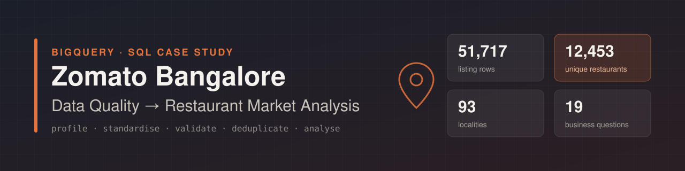
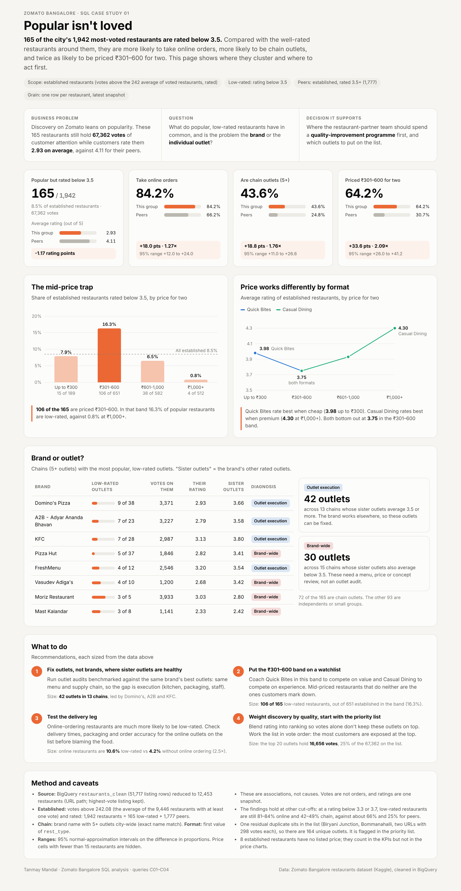
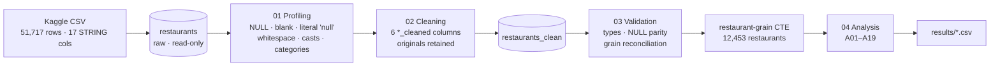

<p align="center">
  
</p>

<p align="center">
  
  
  
  
</p>

# Zomato Bangalore — SQL Data Quality & Restaurant Market Analysis

An end-to-end SQL project in **Google BigQuery**: profile a raw 51,717-row scrape of Zomato's Bangalore listings, standardise and type-cast it into an auditable clean layer, then answer business questions a food-delivery company would ask about localities, ratings, cuisines and online-ordering adoption.

The project's main finding is about the data itself. **The dataset has 51,717 rows, but only 12,453 restaurants are behind them.** Every metric counted per row inflated restaurant counts by about 4× and distorted ratings, so all analysis queries were rebuilt on a deduplicated restaurant grain.

---

## Contents

- [Key findings](#key-findings)
- [Case study: Popular isn't loved](#case-study-popular-isnt-loved)
- [Workflow](#workflow)
- [Repository structure](#repository-structure)
- [Data](#data)
- [Data quality & cleaning](#data-quality--cleaning)
- [Business questions](#business-questions)
- [Selected results](#selected-results)
- [How to reproduce](#how-to-reproduce)
- [Limitations & next steps](#limitations--next-steps)
- [Changelog](#changelog)
- [Related projects](#related-projects)

---

## Key findings

| # | Finding | Evidence |
|---|---|---|
| 1 | **Listings ≠ restaurants.** One restaurant appears in 4.15 listing contexts on average (max 34). The `url` column holds a unique `?context=` query string, so even `COUNT(DISTINCT url)` returns the row count. | [V02](sql/03_validation/02_restaurant_grain_checks.sql) |
| 2 | **Locality rankings change at restaurant grain.** BTM has the most rows (5,124) but only 724 restaurants. **Whitefield is the largest market** with 885 restaurants. | [A01](results/a01_locality_concentration.csv) |
| 3 | **Counting rows inflates ratings.** 11 localities average ≥ 3.8 when counted per listing; **none** do when counted per restaurant. Indiranagar is highest at 3.79, against a city average of 3.63. | [A04](sql/04_analysis/a04_high_rating_low_online_adoption.sql) |
| 4 | **Online-ordering adoption ranges from 44% to 64%** across the 12 localities with 300+ restaurants. HSR leads at 63.9% and Electronic City trails at 44.0%. | [A08](results/a08_cuisine_diversity_and_online_adoption.csv) |
| 5 | **Indiranagar is a delivery opportunity.** It is the best-rated large locality (3.79), yet 48% of its restaurants don't take online orders. | [A04](results/a04_high_rating_low_online_adoption.csv) |
| 6 | **Specialty cuisines get the highest ratings, staple cuisines have the most restaurants.** North Indian is served by 40% of restaurants and is the #1 cuisine in all 12 large localities. European (4.19), Asian (4.07) and BBQ (4.01) have the highest ratings. | [A05](results/a05_top_cuisines_by_presence.csv) · [A06](results/a06_top_rated_cuisines.csv) |
| 7 | **Votes are more concentrated than 80/20.** City-wide, 14.8% of restaurants hold 80% of votes (the top 20% hold 86.1%, Gini 0.824). 29 of the 53 localities with 50+ restaurants beat 80/20: Sarjapur Road is the most concentrated (10.4%), Jeevan Bhima Nagar the flattest (38.5%). | [A09](results/a09_pareto_by_locality.csv) |
| 8 | **Table booking signals quality, not just price.** Booking restaurants rate 0.54 higher overall. Within the same price band the gap is still 0.30–0.40, and 0.36 once price is held constant. | [A10](results/a10_table_booking_vs_rating.csv) |
| 9 | **Budget food looks under-supplied in Basavanagudi and Malleshwaram.** Their up-to-₹300 restaurants draw 3.4× and 2.2× the votes per outlet that the locality and price band predict, without one famous restaurant driving the number. | [A11](results/a11_supply_gaps_by_locality.csv) |
| 10 | **Chains aren't rated higher, they're seen more.** Chain outlets (5+) average 3.63 against 3.62 for independents, but have 2.2× the median votes (47 vs 21) and much more online ordering (70% vs 47%). Independents rate higher in Cafés (3.81 vs 3.59) and Bakeries; chains rate higher in Delivery and Takeaway. | [A12](results/a12_chains_vs_independents.csv) |

## Case study: Popular isn't loved

<a href="case-studies/01-popular-isnt-loved"></a>

**165 of the city's 1,942 most-voted restaurants are rated below 3.5.** Compared with well-rated peers they are more likely to take online orders (84.2% vs 66.2%), to be chain outlets (43.6% vs 24.8%) and to be priced ₹301–600 for two (64.2% vs 30.7%). 42 of them are outlets of chains whose other outlets rate well, so the fix is outlet execution, not the brand.

→ [Read the case study](case-studies/01-popular-isnt-loved) · queries C01–C04, a priority list of the 165 outlets, and an interactive dashboard.

## Workflow



**Working rules:** the raw table is never modified · originals are kept next to cleaned columns · `SAFE_CAST` failures are separated from source NULLs · duplicates are flagged and investigated, never deleted on sight · NULL imputation is deliberately deferred · every step ends with a validation query.

## Repository structure

```text
zomato-bangalore-sql-analysis/
├── CHANGELOG.md            # release and maintenance history
├── sql/
│   ├── 00_source/          # Original BigQuery console scripts, verbatim (audit trail)
│   ├── 01_profiling/       # 13 column-level profiling scripts (00–12)
│   ├── 02_cleaning/        # Cleaning preview + CREATE TABLE restaurants_clean
│   ├── 03_validation/      # Clean-table checks + restaurant-grain reconciliation
│   └── 04_analysis/        # A01–A19 business questions (restaurant grain)
├── case-studies/
│   └── 01-popular-isnt-loved/  # Business case: popular, low-rated restaurants (SQL C01–C04, results, dashboard)
├── results/                # Query outputs captured from BigQuery (CSV)
├── docs/
│   ├── data_dictionary.md          # Raw, cleaned and derived fields
│   ├── data_quality_log.md         # Column tracker, findings, validation results
│   ├── query_review_log.md         # Original attempt vs corrected query, per question
│   └── zomato_data_quality_tracker.xlsx
└── assets/banner.svg
```

## Data

| | |
|---|---|
| **Source** | [Zomato Bangalore Restaurants — Kaggle](https://www.kaggle.com/datasets/himanshupoddar/zomato-bangalore-restaurants) (not redistributed here) |
| **Warehouse** | Google BigQuery (sandbox) — `zomatoanalytics.Zomato_csv` |
| **Raw grain** | One row per listing: restaurant × `listed_in_type` (7) × `listed_in_city` (30) |
| **Analysis grain** | One row per restaurant: `restaurant_id = REGEXP_EXTRACT(url, r'^[^?]+')`, keeping the highest-vote snapshot |

Full field reference: [`docs/data_dictionary.md`](docs/data_dictionary.md)

## Data quality & cleaning

| Column | Issue found | Treatment |
|---|---|---|
| `rate` | `3.9 /5` vs `3.9/5`; 7,775 NULL · 2,208 `NEW` · 69 `-` | `REGEXP_REPLACE(TRIM(rate), r'\s*/\s*', '/')`; numeric rating via `SAFE_CAST(SPLIT(...)[SAFE_OFFSET(0)])` |
| `approx_cost_for_two_people` | `1,800` stored as text; 346 NULL | `SAFE_CAST(REPLACE(TRIM(..), ',', '') AS INT64)` — NULLs preserved, not imputed |
| `votes` | Text type; 0 invalid values | `SAFE_CAST(TRIM(votes) AS INT64)` |
| `address` · `phone` · `menu_item` | Repeated internal whitespace | `REGEXP_REPLACE(TRIM(col), r'\s+', ' ')` |
| `location` vs `listed_in_city` | Same location under up to 21 listing zones | Kept as separate dimensions |
| `rest_type` · `cuisines` | Comma-separated multi-values | Preserved; cuisines exploded with `UNNEST` only at analysis time |
| `url` | Unique per row due to `?context=` | URL path used as the restaurant key |

Validation passed: row count preserved (51,717), no new cast failures (cost NULLs = 346 before and after), rating buckets reconcile to the row count, and the dedup layer has 12,453 restaurants with 0 duplicates.
Details: [`docs/data_quality_log.md`](docs/data_quality_log.md)

## Business questions

| ID | Business question | SQL | Result |
|---|---|---|---|
| A01 | Which localities have the largest restaurant presence, and how are they rated? | [sql](sql/04_analysis/a01_locality_concentration.sql) | [csv](results/a01_locality_concentration.csv) |
| A02 | Which large localities (≥ 500 restaurants) are rated highest? | [sql](sql/04_analysis/a02_investor_high_rated_localities.sql) | [csv](results/a02_investor_high_rated_localities.csv) |
| A03 | Where is online-ordering adoption highest (≥ 300 restaurants)? | [sql](sql/04_analysis/a03_online_ordering_adoption.sql) | [csv](results/a03_online_ordering_adoption.csv) |
| A04 | Where are ratings strong but online adoption low? | [sql](sql/04_analysis/a04_high_rating_low_online_adoption.sql) | [csv](results/a04_high_rating_low_online_adoption.csv) |
| A05 | Which individual cuisines have the widest presence? | [sql](sql/04_analysis/a05_top_cuisines_by_presence.sql) | [csv](results/a05_top_cuisines_by_presence.csv) |
| A06 | Which cuisines (≥ 100 restaurants) are rated highest? | [sql](sql/04_analysis/a06_top_rated_cuisines.sql) | [csv](results/a06_top_rated_cuisines.csv) |
| A07 | Which locality × cuisine pairs are rated highest? | [sql](sql/04_analysis/a07_locality_cuisine_rating_matrix.sql) | [csv](results/a07_locality_cuisine_rating_matrix.csv) |
| A08 | Which localities combine cuisine diversity with online adoption? | [sql](sql/04_analysis/a08_cuisine_diversity_and_online_adoption.sql) | [csv](results/a08_cuisine_diversity_and_online_adoption.csv) |
| A09 | Do 20% of restaurants take 80% of votes, city-wide and in each locality (≥ 50 restaurants)? | [sql](sql/04_analysis/a09_pareto_by_locality.sql) | [csv](results/a09_pareto_by_locality.csv) |
| A10 | Do restaurants with table booking rate higher once price is held constant? | [sql](sql/04_analysis/a10_table_booking_vs_rating.sql) | [csv](results/a10_table_booking_vs_rating.csv) |
| A11 | Which locality × price band cells draw more votes per restaurant than expected (supply gaps)? | [sql](sql/04_analysis/a11_supply_gaps_by_locality.sql) | [csv](results/a11_supply_gaps_by_locality.csv) |
| A12 | Do chain outlets out-perform independent restaurants, overall and by format? | [sql](sql/04_analysis/a12_chains_vs_independents.sql) | [csv](results/a12_chains_vs_independents.csv) |
| A13 | Which dishes do customers single out most, and do restaurants known for them rate higher? | [sql](sql/04_analysis/a13_most_liked_dishes.sql) | [csv](results/a13_most_liked_dishes.csv) |
| A14 | Which listing categories (Delivery, Dine-out, Buffet …) are crowded or premium? | [sql](sql/04_analysis/a14_listing_categories.sql) | [csv](results/a14_listing_categories.csv) |
| A15 | Which localities have the most good (4.0+) and affordable (≤ ₹500 for two) restaurants? | [sql](sql/04_analysis/a15_affordable_quality_by_locality.sql) | [csv](results/a15_affordable_quality_by_locality.csv) |
| A16 | Where are new (not yet rated) restaurants opening? | [sql](sql/04_analysis/a16_new_restaurants_by_locality.sql) | [csv](results/a16_new_restaurants_by_locality.csv) |
| A17 | Which cuisines are priced as premium and which as value? | [sql](sql/04_analysis/a17_cuisine_price_positioning.sql) | [csv](results/a17_cuisine_price_positioning.csv) |
| A18 | Where are the hero restaurants (4.5+ rating, 1,000+ votes)? | [sql](sql/04_analysis/a18_hero_restaurants_by_locality.sql) | [csv](results/a18_hero_restaurants_by_locality.csv) |
| A19 | Which well-rated, popular restaurants still don't take online orders? | [sql](sql/04_analysis/a19_online_ordering_targets.sql) | [csv](results/a19_online_ordering_targets.csv) |

A01–A09 began as practice attempts; A10–A19 were written directly at restaurant grain. The originals are kept verbatim in [`sql/00_source`](sql/00_source), and [`docs/query_review_log.md`](docs/query_review_log.md) records what changed in review and why. One example: the original online-adoption percentage divided by `total × 100` and returned 0 for every locality.

## Selected results

**A01 — Locality concentration (top 8): listing count vs restaurant count**

| Location | Restaurants | Listing rows | Rated restaurants | Avg rating |
|---|---:|---:|---:|---:|
| Whitefield | 885 | 2,144 | 630 | 3.6 |
| Electronic City | 730 | 1,258 | 458 | 3.5 |
| BTM | 724 | 5,124 | 534 | 3.6 |
| HSR | 703 | 2,523 | 527 | 3.6 |
| Marathahalli | 683 | 1,846 | 511 | 3.5 |
| JP Nagar | 523 | 2,235 | 374 | 3.6 |
| Indiranagar | 522 | 2,083 | 440 | 3.8 |
| Bannerghatta Road | 474 | 1,630 | 354 | 3.5 |

**A03 — Online-ordering adoption (localities with ≥ 300 restaurants, top 5)**

| Location | Restaurants | Online-order % | Avg rating |
|---|---:|---:|---:|
| HSR | 703 | 63.87 | 3.64 |
| Sarjapur Road | 338 | 61.24 | 3.60 |
| Jayanagar | 365 | 59.18 | 3.76 |
| BTM | 724 | 56.63 | 3.57 |
| Bannerghatta Road | 474 | 53.16 | 3.48 |

**A06 — Highest-rated cuisines (≥ 100 restaurants, top 5)**

| Cuisine | Restaurants | Avg rating |
|---|---:|---:|
| European | 107 | 4.19 |
| Asian | 214 | 4.07 |
| BBQ | 153 | 4.01 |
| American | 218 | 3.96 |
| Finger Food | 179 | 3.94 |

**A10 — Table booking vs rating (rated restaurants)**

| Segment | With booking | Without | Rating with | Rating without | Gap (95% range) |
|---|---:|---:|---:|---:|---|
| All rated restaurants | 925 | 8,506 | 4.11 | 3.57 | +0.54 (0.52 to 0.56) |
| Up to ₹300 *(small base)* | 7 | 3,279 | 3.86 | 3.54 | +0.31 (0.18 to 0.44) |
| ₹301–600 | 67 | 3,771 | 3.96 | 3.56 | +0.40 (0.30 to 0.49) |
| ₹601–1,000 | 320 | 1,164 | 4.01 | 3.63 | +0.38 (0.34 to 0.43) |
| ₹1,000+ | 531 | 235 | 4.20 | 3.90 | +0.30 (0.24 to 0.36) |
| **Price-adjusted** | | | | | **+0.36** |

**A12 — Chains vs independents (all restaurants)**

| Segment | Restaurants | Avg rating | Rated 4.0+ | Median votes | Online % | Avg cost for two |
|---|---:|---:|---:|---:|---:|---:|
| Chain (5+ outlets) | 2,542 | 3.63 | 25.3% | 47 | 70.3 | ₹460 |
| Independent | 9,911 | 3.62 | 22.0% | 21 | 47.2 | ₹494 |

**A13–A19 — Small business problems**

| ID | Problem | Answer | Action |
|---|---|---|---|
| A13 | Menu planning | Pasta (512 restaurants), Burgers (481) and Biryani (422) are the most-liked dishes. Restaurants known for Cocktails and Mocktails rate 0.36–0.37 above other restaurants with dish data; Paratha and Rolls 0.14 below. | Biryani, Paratha and Rolls are mass-market staples; Pasta, Pizza and Salads go with better-rated, pricier restaurants. |
| A14 | Listing strategy | Delivery (9,320 restaurants) and Dine-out (8,029) dominate, and 7,077 restaurants (57%) are listed in 2+ categories. Drinks & nightlife, Pubs and bars and Buffet are small but premium: ₹1,270–1,446 for two, ratings ~4.0, 55–63% table booking. | Premium categories are the place for booking-led promotions; Delivery is crowded. |
| A15 | Budget-dining guide | 879 restaurants (9.3% of rated) are rated 4.0+ at ≤ ₹500 for two. HSR (59), Jayanagar (55) and Indiranagar (54) have the most; Koramangala 5th Block (20.7%) and Malleshwaram (20.1%) the highest share. | Start a budget guide in Jayanagar, Koramangala 5th Block and Malleshwaram. |
| A16 | Market growth | 596 restaurants (4.8%) are NEW, i.e. not yet rated. Electronic City leads with 86 (11.8% of its restaurants). Only 42.6% of new restaurants take online orders. | Target Electronic City for onboarding; new restaurants are an online-ordering sales pool. |
| A17 | Menu pricing | Of 37 cuisines with 100+ restaurants, 14 price as Premium, 15 Mid and 8 Value. European is the most expensive (₹1,544, 3.17× the city average), Juices the cheapest (₹261). Premium cuisines average 3.89 against 3.63 for Mid and Value. | Premium pricing works for European, Asian and Continental menus; staples compete on price. |
| A18 | Flagship partners | 107 hero restaurants (0.9%). Koramangala 5th Block has the most (15, 5.7 per 100 restaurants), then Indiranagar (13). | A flagship guide can start with Koramangala 5th Block and Indiranagar. |
| A19 | Online-ordering sales list | 177 restaurants rated 4.0+ with 500+ votes, in delivery-friendly formats, don't take online orders. Truffles, Koramangala 5th Block (14,726 votes) tops the list. | Work the list in vote order; buffet chains (Barbeque Nation, AB's) need a separate pitch. |

## How to reproduce

1. Download `zomato.csv` from [Kaggle](https://www.kaggle.com/datasets/himanshupoddar/zomato-bangalore-restaurants) and load it into BigQuery as `<project>.<dataset>.restaurants`, with every column typed as `STRING`.
2. Find and replace `zomatoanalytics.Zomato_csv` with your `<project>.<dataset>` in all files under `sql/`.
3. Run the folders in order: `01_profiling` → `02_cleaning/02_create_restaurants_clean.sql` → `03_validation` → `04_analysis`.
4. Compare your outputs with [`results/`](results).

> Tables in the BigQuery sandbox expire after 60 days. Re-run `02_create_restaurants_clean.sql` to rebuild `restaurants_clean`. Each query scans well under 1 GB, within the free monthly tier.

## Limitations & next steps

- **Missing-value treatment is deferred.** Rows with NULL `location` (11 restaurants) are excluded, and cost NULLs are not imputed.
- **Snapshot choice:** when a restaurant's rating differs between listings, the highest-vote snapshot is used. This is a documented assumption; the scrape has no timestamp.
- **A04 threshold:** the spec's 3.8 cut-off returns no localities at restaurant grain, so 3.7 is applied and the reason is documented in the query.
- **A11 demand index:** votes measure engagement, not orders or revenue, so the index is a screen for where to look, not a market size.
- **Chains (A12):** a brand is a chain when its exact name has 5+ outlets. Spelling variants of one brand count as separate brands.
- **A16 NEW:** an unrated restaurant is a proxy for a recent opening; the scrape has no opening date. **A13:** only 4,631 restaurants (37%) have dish data, mostly popular ones.
- **Next:** splitting `rest_type` into single types, a confidence band for the locality Pareto results, and a Looker Studio dashboard over the results.

## Changelog

Release notes are in [CHANGELOG.md](CHANGELOG.md) (current release: v1.1, 5 Nov 2026).

## Related projects

- [SQL Business Problems](https://github.com/tanmaymandal0207-cmyk/sql-business-problems): problem → SQL → validation case studies in BigQuery
- [IPL Match Intelligence](https://github.com/tanmaymandal0207-cmyk/IPL-Match-Intelligence-Player-Impact-Analysis): MySQL pipeline with data-quality checks and a live dashboard
- [Inventory Reconciliation](https://github.com/tanmaymandal0207-cmyk/inventory-reconciliation): row-level reconciliation of 11 years of challans with an audit register

<p align="right"><a href="#top">↑ Back to top</a></p>

---

**Author:** Tanmay Mandal · [GitHub](https://github.com/tanmaymandal0207-cmyk) · [LinkedIn](https://www.linkedin.com/in/tanmay-mandal-286623247)

© 2026 Tanmay Mandal. All rights reserved. The dataset belongs to its original publisher on Kaggle and is not included in this repository.
