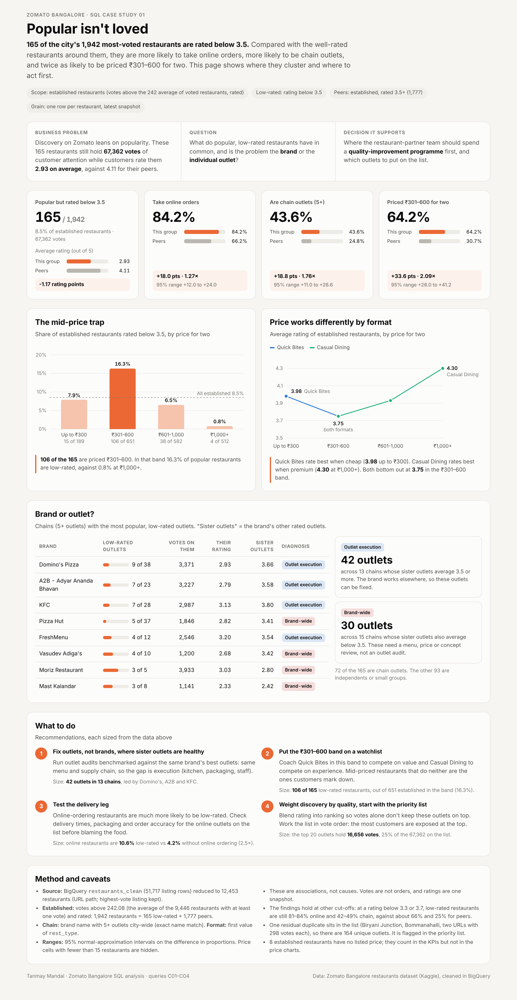

# Case study 01 · Popular isn't loved

**165 of Bangalore's 1,942 most-voted restaurants are rated below 3.5.** This case study looks at who they are, what they have in common, and where a restaurant-partner team should act first.

  

> **Open the interactive dashboard:** [live preview](https://htmlpreview.github.io/?https://github.com/tanmaymandal0207-cmyk/zomato-bangalore-sql-analysis/blob/main/case-studies/01-popular-isnt-loved/dashboard.html) · or download [`dashboard.html`](dashboard.html) and open it in a browser. It is a single self-contained file with no external dependencies, hover tooltips, and light and dark modes.

---

## 1. Business problem

Discovery on Zomato leans on popularity: restaurants with more votes are easier to find and easier to trust. But votes measure attention, not satisfaction. Among the city's established restaurants, **165 hold 67,362 votes of customer attention while customers rate them 2.93 on average**, against 4.11 for the well-rated restaurants around them.

| | |
|---|---|
| **Question** | What do popular, low-rated restaurants have in common, and is the problem the **brand** or the **individual outlet**? |
| **Stakeholder** | Restaurant-partner / key-account team |
| **Decision** | Where to spend a quality-improvement programme first, and which outlets go on the list |

## 2. Scope and definitions

| Term | Rule | Count |
|---|---|---:|
| Restaurant | One row per URL path; the listing row with the highest `votes_cleaned` is kept (ties by `url`) | 12,453 |
| Voted restaurant | `votes > 0` | 9,446 |
| **Established** | `votes` > average of voted restaurants (**242.08**) **and** rating not NULL | **1,942** |
| **Low-rated** | Established and `rating < 3.5` | **165** |
| **Peers** | Established and `rating >= 3.5` | **1,777** |
| Chain outlet | Brand name (exact match) has **5+ outlets** across all 12,453 restaurants | |
| Format | First value of the multi-valued `rest_type` | |

Restaurants with zero votes and those below the average are left out on purpose: a rating built on a handful of votes is too noisy to judge. Reconciliation: 165 + 1,777 = 1,942, and the price-band rows in C02 add back to both totals.

## 3. Findings

### 3.1 KPIs: the low-rated group against its peers

| Metric | Low-rated (165) | Peers (1,777) | Gap | 95% range of gap | Ratio |
|---|---:|---:|---:|---:|---:|
| Average rating | **2.93** | 4.11 | −1.17 | | |
| Take online orders | **84.2%** | 66.2% | +18.0 pts | +12.0 to +24.0 | 1.27× |
| Chain outlet (5+) | **43.6%** | 24.8% | +18.8 pts | +11.0 to +26.6 | 1.76× |
| Priced ₹301–600 for two | **64.2%** | 30.7% | +33.6 pts | +26.0 to +41.2 | 2.09× |

None of the three ranges includes zero. Seen the other way round, an online-ordering restaurant is **2.5× as likely** to be low-rated (10.6% vs 4.2%), and a chain outlet **2.2× as likely** (14.0% vs 6.5%).

### 3.2 The mid-price trap

| Price for two | Established | Low-rated | Low-rated rate | Share of the 165 |
|---|---:|---:|---:|---:|
| Up to ₹300 | 189 | 15 | 7.9% | 9.1% |
| **₹301–600** | **651** | **106** | **16.3%** | **64.2%** |
| ₹601–1,000 | 582 | 38 | 6.5% | 23.0% |
| ₹1,000+ | 512 | 4 | 0.8% | 2.4% |
| Not listed | 8 | 2 | (small base) | 1.2% |

Price works differently by format. **Quick Bites rate best when cheap** (3.98 up to ₹300, 3.75 at ₹301–600). **Casual Dining rates best when premium** (3.75 → 3.93 → 4.30). Both formats bottom out at **3.75 in the ₹301–600 band**, where about one in five established restaurants of each format is rated below 3.5 (Quick Bites 19.1%, Casual Dining 20.4%). The trap is not a format effect.

### 3.3 Brand or outlet?

For each chain with a low-rated established outlet, the brand's **other** rated outlets ("sister outlets") show whether the brand itself works.

| Brand | Low-rated outlets | Votes on them | Their rating | Sister outlets | Diagnosis |
|---|---:|---:|---:|---:|---|
| Domino's Pizza | 9 of 38 | 3,371 | 2.93 | 3.66 | Outlet execution |
| A2B - Adyar Ananda Bhavan | 7 of 23 | 3,227 | 2.79 | 3.58 | Outlet execution |
| KFC | 7 of 28 | 2,987 | 3.13 | 3.80 | Outlet execution |
| Pizza Hut | 5 of 37 | 1,846 | 2.82 | 3.41 | Brand-wide |
| FreshMenu | 4 of 12 | 2,546 | 3.20 | 3.54 | Outlet execution |
| Vasudev Adiga's | 4 of 10 | 1,200 | 2.68 | 3.42 | Brand-wide |
| Moriz Restaurant | 3 of 5 | 3,933 | 3.03 | 2.80 | Brand-wide |
| Mast Kalandar | 3 of 8 | 1,141 | 2.33 | 2.42 | Brand-wide |

Across all 28 chains on the list: **42 outlets in 13 chains** have sister outlets averaging 3.5 or more, so the gap is outlet execution. **30 outlets in 15 chains** belong to brands that rate poorly everywhere. The other 93 of the 165 are independents or small groups. Full list: [`results/c03_low_rated_chain_brands.csv`](results/c03_low_rated_chain_brands.csv).

## 4. Recommendations

| # | Action | Size of the opportunity |
|---|---|---|
| 1 | **Fix outlets, not brands, where sister outlets are healthy.** Audit each outlet against the same brand's best outlets. The menu and supply chain are the same, so the gap is execution: kitchen, packaging, staff. | 42 outlets in 13 chains, led by Domino's, A2B and KFC |
| 2 | **Put the ₹301–600 band on a watchlist.** Coach Quick Bites to compete on value and Casual Dining to compete on experience. | 106 of the 165; 16.3% low-rated rate, nearly twice the 8.5% average |
| 3 | **Test the delivery leg.** For the online outlets on the list, check delivery time, packaging and order accuracy before blaming the food. | Online restaurants: 10.6% low-rated vs 4.2% without online ordering |
| 4 | **Weight discovery by quality.** Blend rating into ranking, and work the [priority list](results/c04_priority_list.csv) in vote order. | Top 20 outlets hold 16,656 votes, 25% of the 67,362 on the list |
| 5 | **Brand-wide cases go to a concept review**, not outlet audits: menu, price point, positioning. | 30 outlets in 15 chains |

## 5. Queries and outputs

All queries run on `zomatoanalytics.Zomato_csv.restaurants_clean` and share the same restaurant-grain CTE as the main project.

| Query | Answers | Output |
|---|---|---|
| [`C01`](sql/c01_popular_low_rated_kpis.sql) | KPI benchmark: low-rated vs peers, gaps with 95% ranges and ratios | [`c01_kpi_benchmark.csv`](results/c01_kpi_benchmark.csv) |
| [`C02`](sql/c02_low_rated_by_price_and_format.sql) | Low-rated rate and average rating by price band, for all established, Quick Bites and Casual Dining | [`c02_low_rated_by_price_and_format.csv`](results/c02_low_rated_by_price_and_format.csv) |
| [`C03`](sql/c03_low_rated_chain_brands.sql) | Chains with low-rated outlets, sister-outlet rating and diagnosis | [`c03_low_rated_chain_brands.csv`](results/c03_low_rated_chain_brands.csv) |
| [`C04`](sql/c04_priority_list.sql) | The 165 outlets ranked by votes, with a residual-duplicate flag | [`c04_priority_list.csv`](results/c04_priority_list.csv) |

**How the outputs were checked:** each query was run against the restaurant-level export of query A09c (12,453 rows), and the results were cross-checked with an independent pandas calculation. Every figure on the dashboard is read from these CSVs.

## 6. Caveats

- **Association, not causation.** Online ordering, chain status and price band go together with low ratings. These data cannot show that they cause them.
- **Votes are not orders**, and ratings are a single snapshot with no timestamp.
- **Robustness:** at a cut-off of 3.3 or 3.7 instead of 3.5, low-rated restaurants are still 81–84% online and 42–49% chain, against about 66% and 25% for peers.
- **One residual duplicate** is on the list (Biryani Junction, Bommanahalli: two URL paths with 298 votes each), so there are 164 unique outlets. It is flagged in C04 and kept, so the counts match the restaurant-grain rule used across the project.
- **Chain** is an exact-name match. Spelling variants of the same brand would count as separate brands.
- Price-band cells with fewer than 15 restaurants are flagged `small base` and hidden on the dashboard.

---

**Author:** Tanmay Mandal · Part of [Zomato Bangalore — SQL Data Quality & Restaurant Market Analysis](../../README.md)
